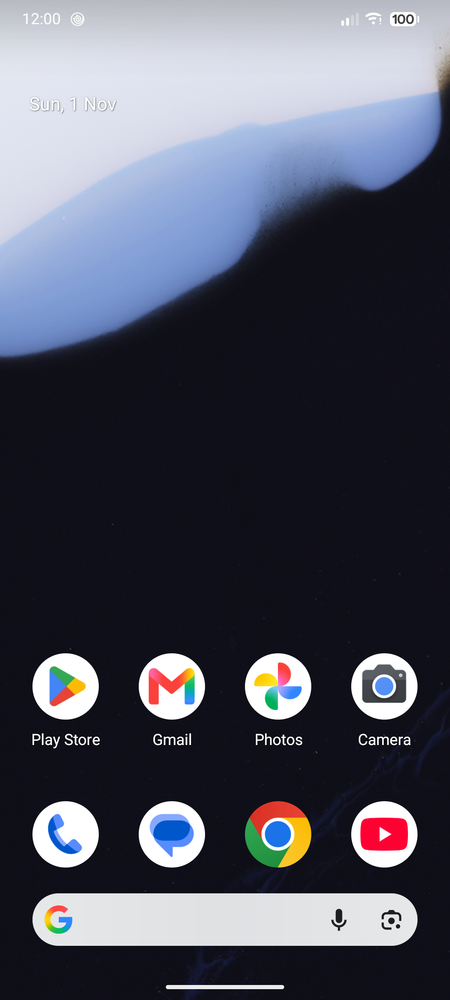
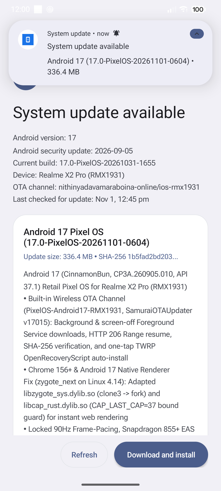
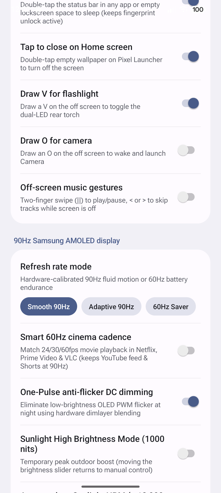
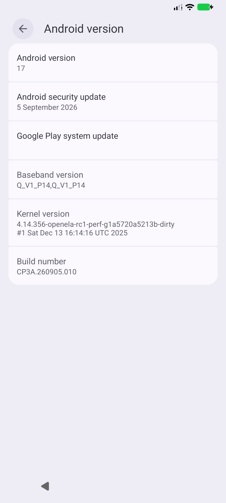
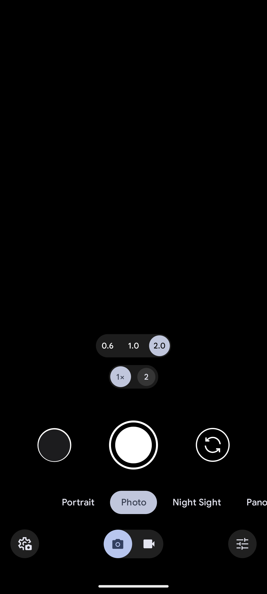
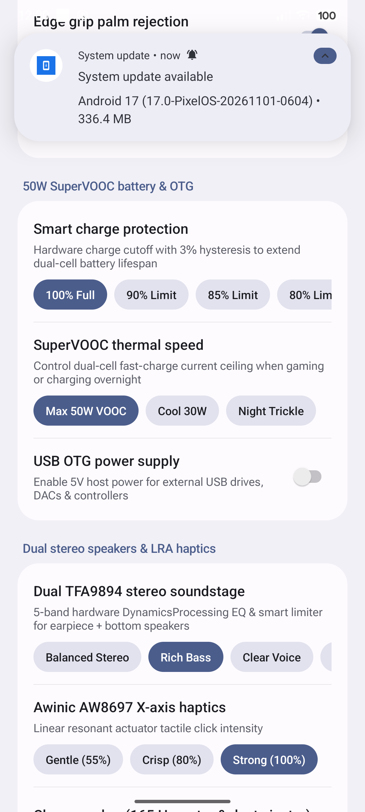

# Pixel OS Android 17 for Realme X2 Pro (`RMX1931` / `samurai`)

[-3DDC84?logo=android&logoColor=white)](https://github.com/nithinyadavamaraboina-online/PixelOS-Android17-RMX1931/releases/latest)
[-FFC915)](https://github.com/nithinyadavamaraboina-online/PixelOS-Android17-RMX1931)
[](https://github.com/nithinyadavamaraboina-online/PixelOS-Android17-RMX1931/blob/main/ota/rmx1931.json)
[](https://xdaforums.com/t/rom-17-0-ota-android-17-for-realme-x2-pro-samurai-rmx1931.4807188/)
[](#hardware--feature-status)

Clean, daily-driver **Retail Google Pixel OS (Android 17 `CinnamonBun`, Build `CP3A.260905.010`, API `37.1`)** built specifically for the **Realme X2 Pro (`RMX1931` / `RMX1931L1` / `samurai`, Snapdragon 855+)** — complete with **built-in Wireless OTA System Updates**, full **SELinux Enforcing** security, **90Hz Samsung AMOLED** tuning, **Hardware Codec2 1080p60/4K60 VP9/HEVC** media acceleration, **50W SuperVOOC**, **Goodix Optical In-Display Fingerprint**, **Quad-Camera Pixel 9 Google Camera 9.6**, and **Pixel XL Original Quality Google Photos** backup.

---

## ✨ Key Highlights

- **Built-in Dual-Channel Wireless OTA Updates (`Settings → System → System update`)**:
  - **Stable Channel (`Default — Pure Google Pixel OS`)**: Quiet, rock-solid daily-driver channel backed by [`ota/stable/rmx1931.json`](ota/stable/rmx1931.json) (and legacy bridge [`ota/rmx1931.json`](ota/rmx1931.json)). Frequent experimental UI updates are paused on Stable — only verified core stability, kernel/HAL, and app compatibility fixes are promoted here.
  - **Opt-In `"iOS Style UI Beta"` Toggle (`Default OFF`)**: Users who want experimental **iOS 26 Liquid Glass UI** updates can flip the **iOS Style UI Beta** switch **ON** inside **Settings → System → System update** to receive beta builds from [`ota/ios-beta/rmx1931.json`](ota/ios-beta/rmx1931.json), and can toggle it **OFF** anytime to return cleanly to Pure Google Pixel OS without wiping `/data`.
  - Dedicated Foreground Download Service (`SamuraiOTAUpdater`) — continues downloading smoothly in the background or with the screen off, supports Pause/Resume (`HTTP 206 Range`), verifies full **SHA-256** integrity + raw UFS block-map plaintext before rebooting, and installs in one tap via TWRP without wiping your data.
- **100% Genuine Android 17 Retail Pixel Experience (`CP3A.260905.010` — Default Stable Channel)**:
  - Pre-bundled Google Play Services (GMS), Play Store, unmodified Retail Google Pixel Launcher (`NexusLauncherRelease` with vertical App Drawer & bottom Search bar), stock Google Phone, stock Google Messages, stock Android 17 Settings, Pixel Wallpaper & Style, Material 3 Expressive SystemUI & Notification Shade tuned for locked 90Hz Adreno 640 SDM HWC2 composition, circular Pixel adaptive icons, and Roboto Flex variable typography.
  - Full Linux `4.14` kernel compatibility layer for Android 17 (`eBPF` tethering/connectivity backport + `zygote_next` isolated native renderer support for Chrome 156+ & WebView) plus Official PixelOS 17.0 Codec2 `c2.qti.vp9.decoder` / `c2.qti.hevc.decoder` performance tables and 90Hz SM8150-AC PowerHAL tuning.
- **Pixel 9 Google Camera 9.6 (`BSG V53`) — All 4 Cameras + Out-of-the-Box 4K 60fps Gyro-EIS3**:
  - Patched Qualcomm Spectra 380 CHI HAL (`Project 19781` + `UsecaseVideo4kEIS3PreviewEIS2` + stream-order-independent binder) exposing all four physical sensors cleanly under `SELinux Enforcing` with **out-of-the-box 4K 60fps & 1080p 60fps Hardware Gyro-EIS3 video stabilization** (pre-seeded `32808` / `32779` session IDs — zero manual XML import needed, works in GCam 9.6 and third-party Camera2 video apps):
    - **`0.6x`** 8MP Ultrawide
    - **`1.0x`** 64MP Samsung GW1 Primary (`HDR+ Enhanced`, `Night Sight` & `4K 60fps EIS3`)
    - **`2.0x`** 13MP Optical Telephoto
    - **Front** 16MP Sony IMX471 Selfie
- **Realme X2 Pro Hardware Hub (`Settings → System → Realme X2 Pro Settings` / `SamuraiParts`)**:
  - **Display**: Locked `Smooth 90Hz`, `Adaptive 90Hz`, or `60Hz Saver`, One-Pulse Anti-Flicker **DC Dimming**, calibrated OLED low-brightness slider + Sunlight **High Brightness Mode (HBM)**, and sRGB / DCI-P3 / Vivid color modes.
  - **Charging**: Full **50W SuperVOOC** fast charging support, Smart Charging Limit (`80%` / `90%` / `100%`), and live wattage/current/temperature telemetry.
  - **Audio & Haptics**: Dual **NXP TFA9894** stereo speaker presets (`Balanced Stereo`, `Rich Bass`, `Clear Voice`), `165 Hz` acoustic water/dust speaker cleaner, and **Awinic AW8697** X-axis LRA haptic intensity control.
  - **Screen-Off Gestures**: Double-Tap to Wake (`DT2W`), Double-Tap Status Bar / Home Screen to Sleep (`DT2S`), Draw `V` for Torch, Draw `O` for Camera, off-screen music gestures, and optional Bottom Navigation Bar visibility toggle.
- **Optional Opt-In `"iOS Style UI Beta"` Channel (`Settings → System → System update`)**:
  - Completely isolated from the default Stable Pixel OS build. When opted in, switches your UI to the experimental **iOS 26 Liquid Glass Suite** (`90Hz` AGSL Liquid Glass Home Screen Dock & `"Q Search"` pill, 129 multi-plane iOS 26 squircle icons, left/right **iOS 26 Notification Center & Control Center** + **Lock Screen**, standalone `IosSettings`, clean-room `IosDialer` Phone + Live Call Screen, `IosMessages`, and `iOS Styler` with `20%` Refraction / `20%` Frost / `70%` Wallpaper Depth defaults) while sharing the exact same verified kernel, camera, Chrome/WebView, and hardware fixes.
- **Pixel Backup & Optional Privacy Browser**:
  - Out-of-the-box **Pixel XL Original Quality Google Photos** backup, native Android Private DNS (DoT/QUIC) compatibility, and one-tap verified **Cromite Browser** installation.

---

## 📸 Screenshots

| Home Screen (Android 17) | Built-in Wireless OTA | 90Hz AMOLED & Gestures |
| :---: | :---: | :---: |
|  |  |  |

| Android 17 & 4.14 Kernel | Pixel 9 GCam 9.6 (`0.6x`/`1x`/`2x`) | 50W SuperVOOC & Stereo EQ |
| :---: | :---: | :---: |
|  |  |  |

---

## 📊 Hardware & Feature Status

| Component | Status | Notes |
| :--- | :---: | :--- |
| **RIL / Dual-SIM VoLTE / VoWiFi / 4G+** | ✅ Working | Jio, Airtel, Vi & global LTE bands |
| **Wi-Fi (2.4GHz / 5GHz) & Hotspot** | ✅ Working | Full Android 17 mainline eBPF tethering on 4.14 |
| **Bluetooth 5.0 & High-Res Audio** | ✅ Working | SBC, AAC, aptX, aptX HD, aptX TWS+, LDAC |
| **90Hz AMOLED + HBM + DC Dimming** | ✅ Working | Samsung `SOFEF03F-M` calibrated, 0% Launcher jank |
| **In-Display Fingerprint (UDFPS)** | ✅ Working | Goodix G3 optical sensor (screen-on & AoD) |
| **Quad Rear + Front Cameras (GCam 9.6)** | ✅ Working | `0.6x` UW, `1x` 64MP, `2x` Tele, `16MP` Front + **4K 60fps Gyro-EIS3** |
| **50W SuperVOOC Fast Charging** | ✅ Working | Smart charge limit & thermal protection supported |
| **Dual Stereo Speakers + 3.5mm Jack** | ✅ Working | Dual TFA9894 amps + 5-band hardware EQ |
| **NFC / GPS / Sensors / OTG** | ✅ Working | Dual-frequency L1+L5 GNSS |
| **SELinux** | ✅ **Enforcing** | Full Treble CIL policy compiled cleanly |
| **Wireless OTA Updates** | ✅ Working | Built into **Settings → System → System update** |

---

## 📦 Downloads

Grab the latest release files from the [**GitHub Releases Page**](https://github.com/nithinyadavamaraboina-online/PixelOS-Android17-RMX1931/releases/latest):

| Package | When to Use | Approximate Size |
| :--- | :--- | :---: |
| **`RMX1931-Android17-PixelOS-VendorBoot.zip`** | **First-time Clean Flash — Step 1 of 2** (Vendor + Dual `EXT4`/`F2FS` `/data` fstab + Goodix UDFPS ODM + Linux `4.14.356` Kernel + `dtbo` + `Flags=3` `vbmeta` + clean `/metadata` format) | `~858 MiB` |
| **`RMX1931-Android17-PixelOS-System.zip`** | **First-time Clean Flash — Step 2 of 2** (Full Pure Google Pixel OS `v2.1.7` Stable + Google Apps + 4K60 EIS3 GCam 9.6 + Goodix G3 Optical UDFPS + Chromium/Brave Native Renderer Fix + Dual-Channel OTA Engine) | `~1.85 GiB` |
| **`RMX1931-Android17-PixelOS-OTA.zip`** | **Wireless Pure Pixel OS Update (`v2.1.7`) — Existing Installs ONLY** (Downloaded automatically by **Settings → System → System update** on `v1.x` / `v2.0` / `v2.1.x` — **do NOT use for a first-time clean flash!**) | `~40 MiB` |

> **Why is the first-time Clean Flash split into `VendorBoot.zip` + `System.zip`?**
> GitHub Releases enforces a `2.0 GiB` per-file limit, while a full Android 17 + GMS + GCam 9.6 image totals `~2.72 GiB`. Splitting Vendor/Boot (`[1/2]`) and System (`[2/2]`) keeps 100% of downloads fast and ad-free directly on GitHub Releases. You can queue both ZIPs together in TWRP in a single swipe — and **once installed, all future updates arrive as compact Wireless OTAs!**

Always verify checksums against `SHA256SUMS.txt` attached to each GitHub Release.

---

## 🛠️ How to Install (Step-by-Step)

> ⚠️ **Warning**: Unlocking the bootloader and clean-flashing a new ROM will erase internal storage when formatting `/data`. Back up all photos, chats, and personal files to a PC or USB drive first. **Never** flash firmware partitions (`abl`, `xbl`, `tz`, `modem`, `persist`) from another device, and **never** relock the bootloader on custom software.

### Prerequisites
1. **Realme X2 Pro (`RMX1931` / `RMX1931L1`, codename `samurai`)** with an **Unlocked Bootloader**.
2. **Realme UI 2.0 (Android 11, `RMX1931EX_11_C.36` or newer) base firmware** already installed on the device.
   - *(The installer automatically verifies TrustZone `TZ.XF.5.2` so you cannot accidentally boot on incompatible ColorOS 6 / Realme UI 1.0 firmware — if you see Error `E3005`, update to Realme UI 2.0 first.)*
3. **TWRP Recovery (`3.7.x` for `RMX1931` / `samurai`)** installed:
   ```bash
   fastboot flash recovery twrp-3.7.x-RMX1931.img
   fastboot reboot recovery
   ```
4. **Google Apps (GApps) are ALREADY included** — **do NOT** flash NikGApps, MindTheGApps, or any separate GApps package!

---

### Method A: First-Time Clean Flash (Coming from Realme UI 2.0 or Any Other ROM)

1. Download **`RMX1931-Android17-PixelOS-VendorBoot.zip`** and **`RMX1931-Android17-PixelOS-System.zip`** to a PC or USB-OTG drive.
2. Boot your Realme X2 Pro into **TWRP Recovery** (`Power + Volume Down`, or `adb reboot recovery`).
3. Tap **Wipe → Advanced Wipe**, select:
   - `Dalvik / ART Cache`
   - `Cache`
   - `System`
   - `Vendor`
   - `Data`
   *(Do **not** wipe `Persist`!)* — and **Swipe to Wipe**.
4. Copy both ZIPs to the phone over USB MTP (or plug in your USB-OTG drive) and tap **Install** *(order matters — enforced automatically by pre-flight guard `E1000`)*:
   - Select **`RMX1931-Android17-PixelOS-VendorBoot.zip`** **FIRST** (`[1/2]`).
   - Tap **Add more Zips** and select **`RMX1931-Android17-PixelOS-System.zip`** **SECOND** (`[2/2]`).
   - **Swipe to confirm Flash** (waits ~2–3 minutes until `Part [2/2] Android 17 Pixel OS System (v2.1.4) complete!` appears).
5. Go back to **Wipe → Format Data** (the button on the right), type **`yes`**, and tap the blue checkmark.
   - *(⚠️ **Important**: Use **Format Data → `yes`** — do **NOT** use "Swipe to Factory Reset / Wipe Data"! Both **`EXT4`** and **`F2FS`** `/data` filesystems are supported out of the box on TWRP `3.7.0_12-0`+.)*
6. Tap **Reboot → System**.
   - First boot takes **~2–3 minutes** on the Google G animation while Android 17 compiles initial caches, then greets you with the Pixel Setup Wizard!

---

### Method B: Built-in Wireless OTA Updates (Updating Existing Pixel OS Android 17 Installs)

Once you are running Pixel OS Android 17, **you never need a PC or data wipe to update**:

1. Open **Settings → System → System update** on your phone.
2. Tap **Check for update**. When a newer build is published to this repository, the full changelog, version, and package size are shown.
3. Tap **Download update**:
   - Downloads run inside a dedicated foreground service — you can **close the app, use other apps, or lock your screen**, and progress continues in your notification shade with Pause / Resume support.
   - Once downloaded, the updater automatically verifies the **SHA-256** checksum against the signed release manifest.
4. Tap **Reboot & install**:
   - Your phone automatically reboots into TWRP Recovery, installs the update via OpenRecoveryScript while keeping **100% of your apps, photos, and `/data` intact**, clears stale system caches, and boots straight back into Android 17!

*(Prefer updating manually offline? Download `RMX1931-Android17-PixelOS-OTA.zip` and either tap **Local update** inside **Settings → System → System update**, or flash it directly in TWRP **without** formatting Data.)*

---

## ❓ Troubleshooting & Tips

- **Error `E1000` / `E1002` in TWRP**:
  - `E1000` means `System.zip` (`[2/2]`) was flashed before `VendorBoot.zip` (`[1/2]`) on a first-time clean flash — flash **`RMX1931-Android17-PixelOS-VendorBoot.zip` FIRST**, then **`System.zip` SECOND**.
  - `E1002` means the small `~40 MiB` `OTA.zip` was flashed onto Stock Realme UI or another ROM — `OTA.zip` is strictly for updating existing Pixel OS Android 17 installs; use `VendorBoot.zip` + `System.zip` for a first-time clean flash.
- **Error `E3005` in TWRP**: Your phone is still on old Android 9/10 firmware. Flash stock Realme UI 2.0 (`C.36`+) firmware first, re-flash TWRP, and repeat Method A.
- **Reboots to Bootloader / Fastboot or stuck on boot logo after Clean Flash**: Ensure you flashed **updated `v2.1.4+` `VendorBoot.zip` `[1/2]` + `System.zip` `[2/2]`** (which adds native **`F2FS` + `EXT4`** `/data` support for `TWRP 3.7.0_12-0` and clean `/metadata` formatting) AND performed Step 5 (**Wipe → Format Data → type `yes`**, **NOT** *Swipe to Factory Reset / Wipe Data*).
- **Using Custom Private DNS (`dns.adguard-dns.com` / `dns.nextdns.io`)**: Native Android Private DNS (DoT/DoH3) works out-of-the-box under **Settings → Network & internet → Private DNS** with zero packet-inspection latency in Chrome or YouTube.
- **Changing Refresh Rate / DC Dimming / SuperVOOC Smart Charge Limit**: Open **Settings → System → Realme X2 Pro Settings** (or long-press the **90Hz**, **DC Dim**, or **Sunlight HBM** Quick Settings tiles).

---

## 📜 Source Code & GPLv2 Credits

- **Linux Kernel Source (`GPLv2`, `4.14.356-openela`)**:
  - Device Kernel Tree (`sm8150` / `samurai`): [HyperTeam/android_kernel_realme_sm8150](https://github.com/HyperTeam/android_kernel_realme_sm8150)
  - Upstream OpenELA 4.14 LTS Base: [openela/kernel-lts](https://github.com/openela/kernel-lts)
- **Device & Recovery Reference Trees**:
  - Realme X2 Pro (`samurai`) Device Tree: [HyperTeam/android_device_realme_samurai](https://github.com/HyperTeam/android_device_realme_samurai)
  - TWRP Device Tree (`RMX1931`): [HyperTeam/twrp_device_realme_RMX1931](https://github.com/HyperTeam/twrp_device_realme_RMX1931)
- **OTA Manifest Channel**: [`ota/rmx1931.json`](ota/rmx1931.json)
- **Special Thanks**: Google AOSP & Pixel Team, PixelOS Team, HyperTeam (`RMX1931` trees & 4.14 kernel bring-up), BSG (`MGC 9.6`), and the `uazo/cromite` open-source project.
